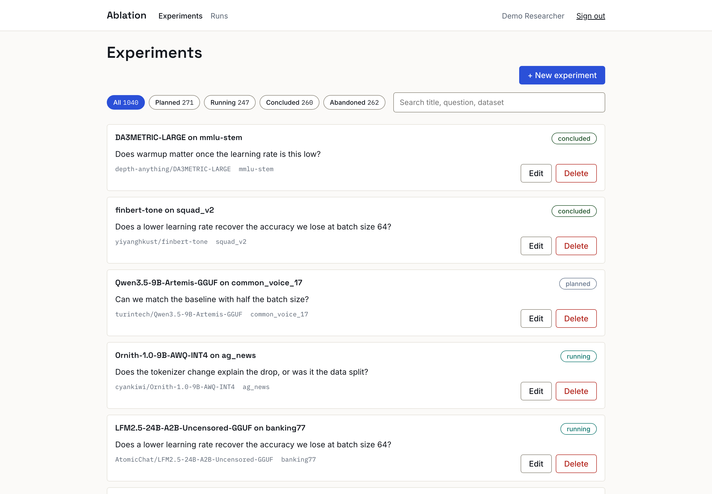
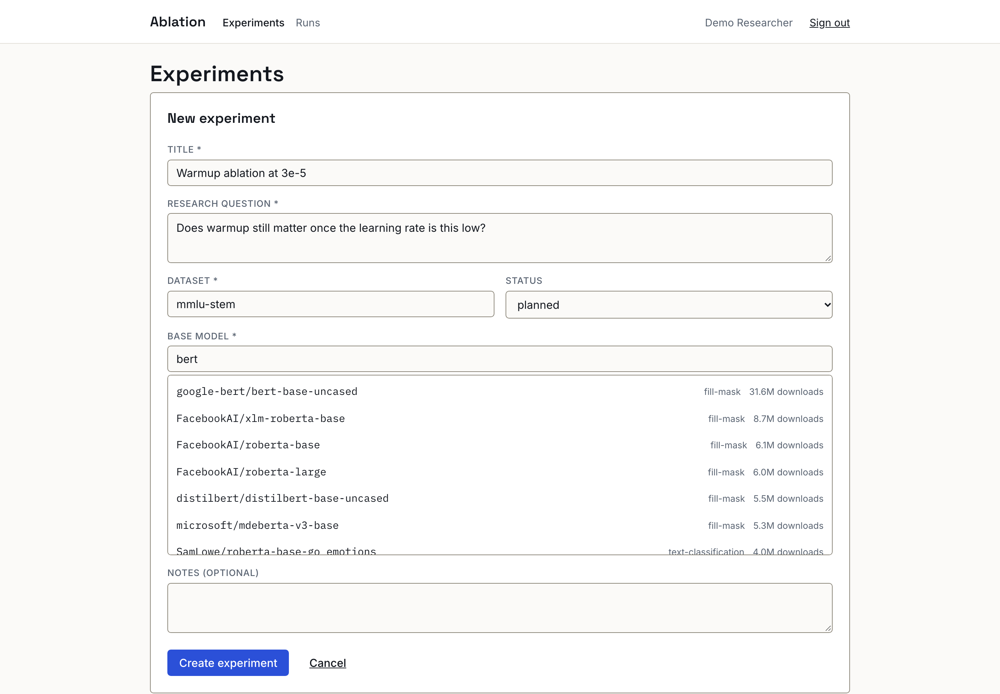

# Ablation

A log for machine learning experiments: what you changed, what it scored, and whether
you could get the number back.

## Authors

Mayank Tamakuwala and Varshith Sai Pothula

Built for [CS 5610 Web Development](https://northeastern.instructure.com/courses/261032),
Khoury College, Northeastern University, Fall 2026.

## Objective

Training runs are cheap to start and almost impossible to reconstruct. Three weeks after
a result you have a number in a Slack thread, a checkpoint directory called `run_14_final`,
and no record of which of the six things you changed that afternoon actually produced it.
Weights and Biases solves this for teams who set it up in advance. Nobody solves it for the
person who is one week into a project and already lost.

Ablation is built around the field those tools treat as optional: the question. Every
experiment starts with something you are actually trying to find out, written in a sentence,
before any run exists. The dataset, the base model and the status hang off that question
rather than the other way around. A catalog of 1,000 models pulled from the Hugging Face
Hub means the base model is a real identifier you picked from a list, not a string you typed
from memory and spelled differently the second time.

It is also a course project, so under the hood it is a demonstration of Node, Express and
the MongoDB driver behind a React client, with Passport handling sessions. No Mongoose, no
axios, no CORS middleware.

## Screenshots

The experiment list, signed in as the demo account. The chips across the top are per status
counts that stay accurate while you search, and the list pages through 1,040 seeded records
twenty at a time.



Creating an experiment. The base model field searches the seeded catalog and shows each
model's task and download count, so you pick an identifier rather than typing one.



## What it does

Sign in, and you get your own list of experiments. Nobody else's records are reachable, and
a request for an experiment belonging to another account returns 404 rather than 403, so the
API cannot be used to find out which ids exist.

**Define an experiment** with a title, the research question you are trying to answer, the
dataset, a base model from the catalog, a status and optional notes. Only the question and
the base model are the interesting part. Everything else is bookkeeping.

**Work through the list.** Filter to one of four statuses (planned, running, concluded,
abandoned) using the chips, which carry live counts. Search across title, question and
dataset. Both narrow the same query, and the counts respect the search while ignoring the
status filter, because the chips are how you change status in the first place. Results page
twenty at a time.

**Edit in place.** The same form opens pre-filled against an existing record, so correcting
a dataset name does not mean retyping the question.

**Delete with a confirmation.** The dialog is a native `<dialog>` opened with `showModal()`,
which means the focus trap, the backdrop, the inert background and the Escape key are the
browser's behaviour rather than something reimplemented in JavaScript.

The header shows a second section, Runs, which is the other half of the project.

## Running it locally

You need Node 20 or newer and a MongoDB database. A free Atlas M0 cluster works, and so
does Mongo in Docker.

```bash
git clone https://github.com/MayankTamakuwala/Ablation.git
cd Ablation
npm install
cp .env.example .env
```

Open `.env` and set `MONGODB_URI`. For Atlas, go to Network Access and allow `0.0.0.0/0`,
otherwise your own address is blocked. For a local database:

```bash
docker run -d --name ablation-mongo -p 27017:27017 mongo:8
# then set MONGODB_URI=mongodb://127.0.0.1:27017 in .env
```

Populate the database:

```bash
npm run seed
```

That pulls the 1,000 most downloaded models from the Hugging Face Hub, generates 1,040
synthetic experiments, and creates a demo account to own them. It needs no API key and
takes about twenty seconds. It prints the demo credentials when it finishes:

```
demo / ablation2026
```

Then start the two development processes, in two terminals:

```bash
npm run dev                  # Express API on http://localhost:3000
npm --prefix client run dev  # React client on http://localhost:5173
```

Open http://localhost:5173 and sign in as `demo`, or register your own account, which
starts empty.

Two processes is a development-only arrangement. Vite serves the client and proxies `/api`
through to Express so the browser sees a single origin, which is what keeps the session
cookie working. In production there is one origin for real and no proxy.

### Scripts

| Command                       | What it does                                  |
| ----------------------------- | --------------------------------------------- |
| `npm run dev`                 | Express API on port 3000, reads `.env`        |
| `npm --prefix client run dev` | Vite dev server on port 5173                  |
| `npm run seed`                | Fetch models and generate experiments         |
| `npm run build`               | Install and build the client to `client/dist` |
| `npm run lint`                | ESLint across server, scripts and client      |
| `npm run format`              | Format everything with Prettier               |
| `npm run format:check`        | Check formatting without writing              |

## Project layout

```
api/index.js                Vercel entry, exports the Express app without listening
server/
  app.js                    Express setup, sessions, error handling
  local.js                  Development only, the one file that calls listen()
  validate.js               Request validation, field limits, status whitelist
  auth/password.js          scrypt hashing with a per user salt
  auth/passport.js          Local strategy and the requireAuth guard
  db/client.js              MongoClient cached across serverless invocations
  db/users.js               User lookup and creation
  db/experiments.js         Queries for the experiments collection
  db/models.js              Read only queries for the model catalog
  routes/auth.js            Register, sign in, sign out, session check
  routes/experiments.js     CRUD for experiments
  routes/models.js          Catalog search and task list
scripts/seed.js             Hugging Face models plus synthetic experiments
client/
  index.html                Single page shell
  src/main.jsx              React entry
  src/App.jsx               Session check, then sign in or the list
  src/lib/api.js            Every fetch call in the client lives here
  src/components/           One component per file, each with its own CSS module
  src/styles/               Design tokens, resets, shared control styles
docs/                       Design document and screenshots
wireframe/                  The wireframes the design document is built on
```

## API

Everything under `/api` returns JSON. Every route except register and sign in requires an
authenticated session, carried in an `httpOnly` cookie.

| Method | Route                  | Purpose                                                    |
| ------ | ---------------------- | ---------------------------------------------------------- |
| GET    | `/api/health`          | Liveness check                                             |
| GET    | `/api/auth/me`         | The signed in user, or `null`                              |
| POST   | `/api/auth/register`   | Create an account and sign in                              |
| POST   | `/api/auth/login`      | Sign in                                                    |
| POST   | `/api/auth/logout`     | Destroy the session                                        |
| GET    | `/api/experiments`     | Your experiments, with `status`, `search`, `limit`, `skip` |
| POST   | `/api/experiments`     | Create one                                                 |
| GET    | `/api/experiments/:id` | One experiment                                             |
| PUT    | `/api/experiments/:id` | Update one                                                 |
| DELETE | `/api/experiments/:id` | Delete one                                                 |
| GET    | `/api/models`          | Catalog search, with `search`, `task`, `limit`             |
| GET    | `/api/models/tasks`    | Distinct task names and the catalog size                   |

The list endpoint returns `{ items, total, counts, limit, skip }`. `counts` holds the per
status totals the filter chips display.

## A few notes on how it is built

**Sessions live in Mongo, not in memory.** The app is deployed as a serverless function,
and two requests are not guaranteed to reach the same instance, so an in-memory session
store would sign people out at random. `connect-mongo` puts them in a `sessions`
collection instead. The Mongo client itself is cached on `globalThis` for the same reason,
so a thawed function reuses its connection pool rather than opening a new one per request.

**Deployment is a single Vercel project.** `npm run build` produces `client/dist`, which
Vercel serves as static files, and `api/index.js` runs Express as a serverless function. A
rewrite in `vercel.json` sends `/api/*` to it. Both come from one domain, so there is no
cross origin request anywhere and the app needs no CORS middleware at all.

**Passwords use `crypto.scrypt`** from the Node standard library rather than bcrypt. It
needs no native build step, which matters on a platform that installs dependencies fresh on
every deploy, and comparison goes through `timingSafeEqual`.

**Sign in gives the same error** for an unknown username and a wrong password. Different
messages would turn the form into a way to find out which accounts exist.

**Pagination sorts by `updatedAt` and then `_id`.** Without the tiebreak, records sharing a
timestamp can shift between pages as you move through them, and the same row shows up twice.
The seed produces many identical timestamps, so this is not theoretical.

## Design document

The design document, with personas, user stories, wireframes and the accessibility
decisions behind the palette, is at
[docs/DESIGN-DOCUMENT.pdf](docs/DESIGN-DOCUMENT.pdf).

## License

MIT. See [LICENSE](LICENSE).

## Data

The model catalog comes from the [Hugging Face Hub](https://huggingface.co) public API,
which is free and needs no key. Experiment records are synthetic, generated by a seeded
pseudorandom number generator so the same seed produces the same database.
